# StudySpace — Student Study Planner

StudySpace is a full-stack web application that helps students keep track of courses and assignments in one place. Students can create assignments, choose a course, set a due date and priority, update progress, and review an overview of their workload. The project was built as a Session 21 DevOps capstone and demonstrates the path from a working application through automated testing, container builds, image security scanning, cloud deployment, and monitoring.

**Project status:** the local app can be run with Docker Compose. The AWS demo was deployed in `ap-southeast-2` to collect evidence and then destroyed; the EKS cluster, VPC, and load balancer are no longer running. Cloud screenshots below document that temporary deployment.

**Source repository:** [TanushShoor/devops-project](https://github.com/TanushShoor/devops-project) · **Final successful CI run:** [StudySpace CI/CD run #14](https://github.com/TanushShoor/devops-project/actions/runs/38807499658)

## What the application does

- Shows an overview of assignment totals and work due soon.
- Lets students create, view, update, and delete assignments.
- Tracks assignment status as `TODO`, `IN_PROGRESS`, or `DONE`.
- Supports `LOW`, `MEDIUM`, and `HIGH` priority.
- Associates work with courses and due dates.
- Exposes health, readiness, and Prometheus metrics endpoints for operations.

The interface is built with React and Vite. It calls a FastAPI REST API; the API uses SQLAlchemy to store assignment data in PostgreSQL. Alembic manages database schema migrations.

### Application screenshot

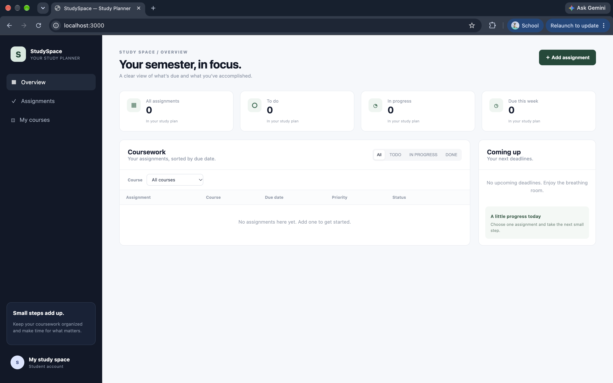

The evidence capture shows the dashboard's initial empty state, ready for a student to add assignments.

## Architecture

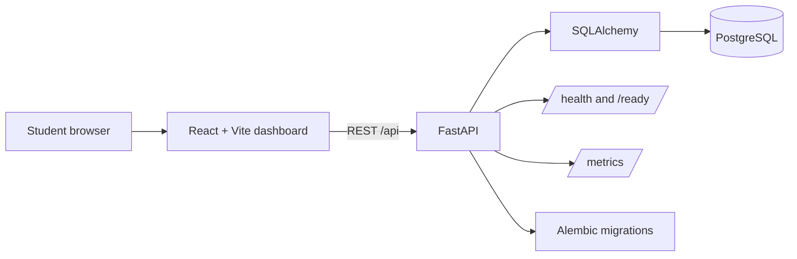

In local development, Docker Compose starts the frontend, API, and PostgreSQL. In the cloud demo, Kubernetes Services routed traffic to the frontend and API pods, while an NGINX Ingress Load Balancer exposed the app. Prometheus scraped the backend metrics and Grafana displayed the API dashboard.

## Technology and project structure

| Area | Technologies and files |
| --- | --- |
| Frontend | React, Vite, NGINX unprivileged runtime in `frontend/` |
| API | Python 3.12, FastAPI, SQLAlchemy in `backend/app/` |
| Database | PostgreSQL, Alembic migrations in `backend/alembic/` |
| Tests | pytest API tests in `backend/tests/` |
| Local runtime | `docker-compose.yml` and service Dockerfiles |
| CI and image security | `.github/workflows/ci-cd.yml`, Trivy, GitHub Container Registry |
| Cloud infrastructure | Terraform VPC and EKS definitions in `terraform/` |
| Kubernetes packaging | Helm chart in `helm/taskboard/`; namespace resources in `k8s/` |
| Monitoring | Prometheus configuration and Grafana dashboard in `monitoring/` |
| Evidence | Screenshots in `evidence/` |

## Run the application locally

### Requirements

- Docker Desktop with Docker Compose
- A browser

From the repository root, start the entire stack:

```bash
docker compose up --build
```

Open the frontend at [http://localhost:3000](http://localhost:3000). The FastAPI documentation is at [http://localhost:8000/docs](http://localhost:8000/docs). The backend exposes `/health`, `/ready`, and `/metrics` on port `8000`. Compose waits for the database and backend health checks before starting dependent services; the backend applies its Alembic migration during startup.

The services use these local ports:

| Service | Local address |
| --- | --- |
| StudySpace frontend | `http://localhost:3000` |
| FastAPI | `http://localhost:8000` |
| PostgreSQL | `localhost:5432` |

To stop the containers, press `Ctrl+C` in the Compose terminal or run:

```bash
docker compose down
```

To remove the local PostgreSQL data volume as well, run `docker compose down -v`.

### Docker Compose evidence

The first capture shows the stack starting; the second shows the running containers.

<p align="center">
  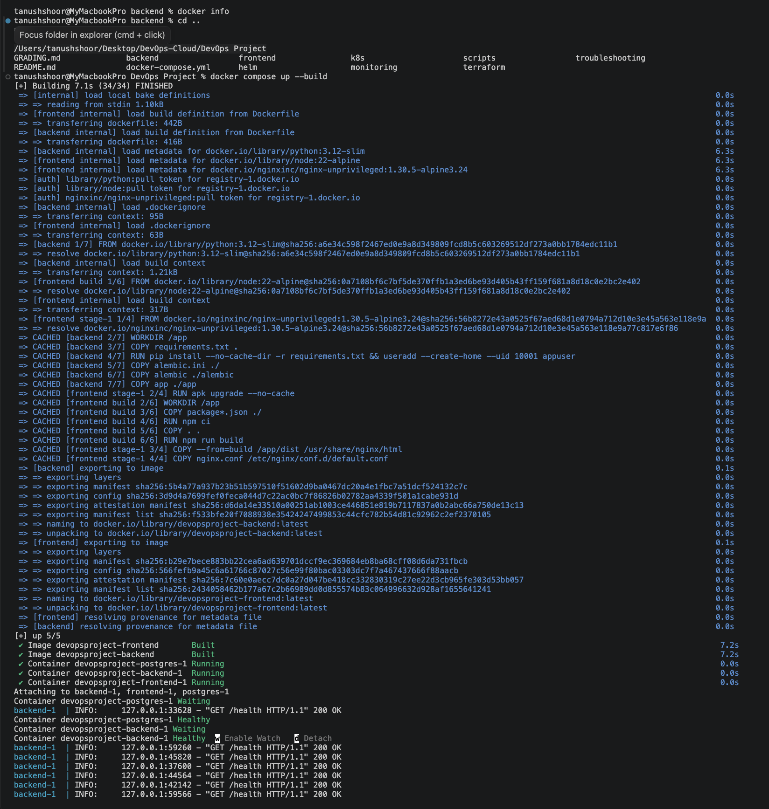
  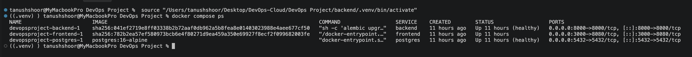
</p>

## API overview

| Method | Path | Purpose |
| --- | --- | --- |
| `GET` | `/api/assignments` | List assignments, ordered by due date |
| `GET` | `/api/assignments/{id}` | Fetch one assignment |
| `POST` | `/api/assignments` | Create an assignment |
| `PUT` | `/api/assignments/{id}` | Update an assignment |
| `DELETE` | `/api/assignments/{id}` | Delete an assignment |
| `GET` | `/api/assignments/stats` | Return assignment status counts and due-soon totals |
| `GET` | `/health` | Liveness check |
| `GET` | `/ready` | Database readiness check |
| `GET` | `/metrics` | Prometheus metrics |

## Run the backend tests

The test suite uses a temporary in-memory SQLite database, so it does not read or modify the PostgreSQL database used by Docker Compose. Python 3.12 is required for the documented setup:

```bash
cd backend
python3.12 -m venv .venv
source .venv/bin/activate
python -m pip install -r requirements.txt
pytest -v
```

The captured test run shows **6 passed**. Coverage includes health and root responses, assignment create/list/update/delete, statistics, and invalid-priority validation. The capture includes one non-failing Starlette/httpx deprecation warning.

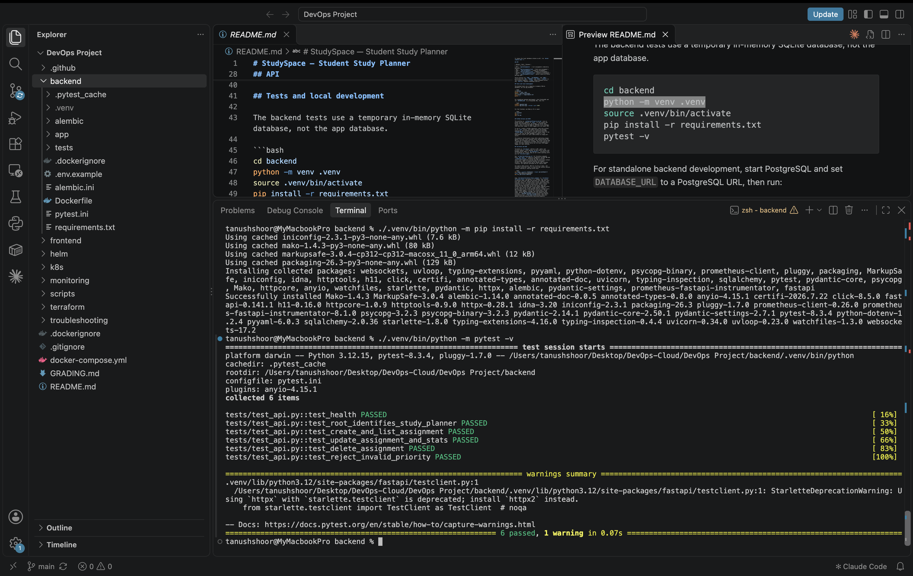

## Git, CI/CD, and container security

The workflow in [`.github/workflows/ci-cd.yml`](.github/workflows/ci-cd.yml) runs on pull requests and pushes to `main`. It checks the backend with Python 3.12 and pytest, then builds the frontend with Node 22. A push to `main` also builds the backend and frontend container images, scans both images with Trivy, and publishes them to GitHub Container Registry (GHCR) tagged with the full source commit SHA.

The captured final run is green for commit `79d3c64ff7b39f73562a1e501609b2baf6e1423a`. The deployment to AWS is a separate, manually authenticated CLI step after CI; AWS credentials and kubeconfig are not stored in GitHub Actions or this repository.

<p align="center">
  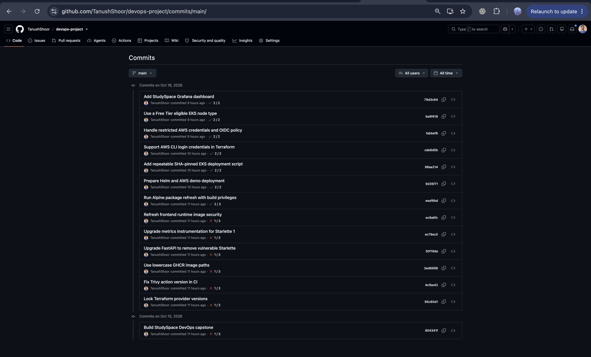
  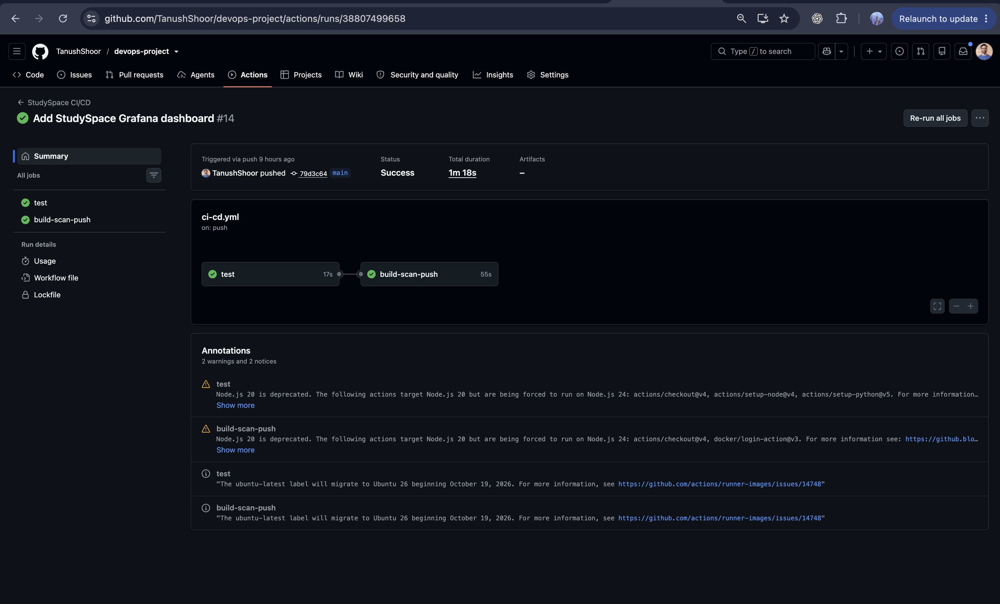
</p>

### Trivy scanning and published images

The workflow fails on unfixed HIGH or CRITICAL image findings. The captured backend and frontend Trivy reports each show zero vulnerabilities for those scanned images at that point in time. Both images were published to GHCR with commit-specific SHA tags:

- `ghcr.io/tanushshoor/study-planner-backend:<full-commit-sha>`
- `ghcr.io/tanushshoor/study-planner-frontend:<full-commit-sha>`

<p align="center">
  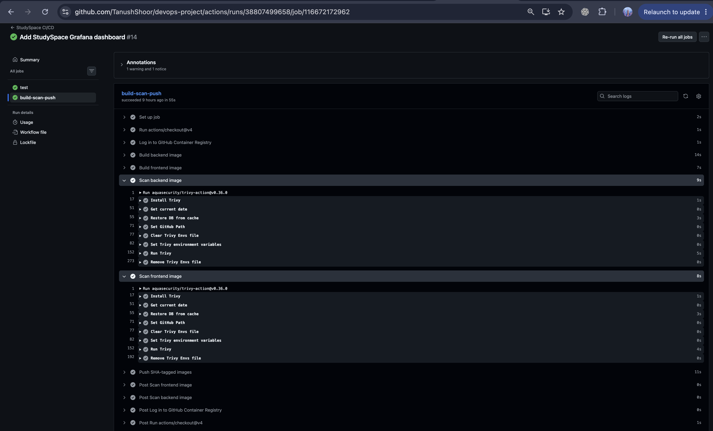
  
</p>
<p align="center">
  
  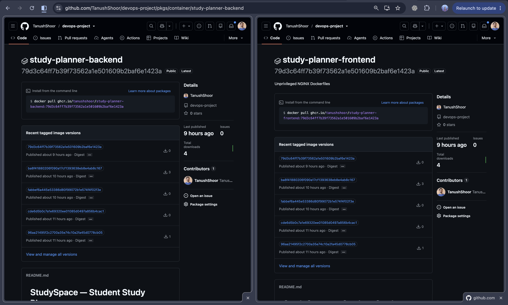
</p>

## AWS infrastructure with Terraform

Terraform created a VPC with two public and two private subnets and one NAT gateway, then provisioned the EKS control plane and managed worker nodes in `ap-southeast-2`. The demo used a two-node `t3.small` managed node group. IRSA was disabled because the student account's AWS Organizations policy blocked OIDC provider creation; the demo workloads did not require IRSA. The script [`scripts/terraform-aws.sh`](scripts/terraform-aws.sh) passes short-lived AWS CLI login credentials to Terraform through a credential process.

The AWS resources have been destroyed after evidence collection. Screenshots below show the environment while it was live.

The following two screenshots are post-apply Terraform checks; both show no remaining changes.

<p align="center">
  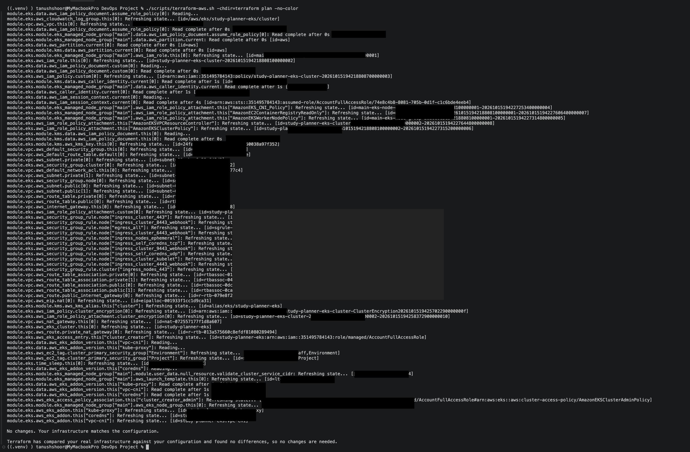
  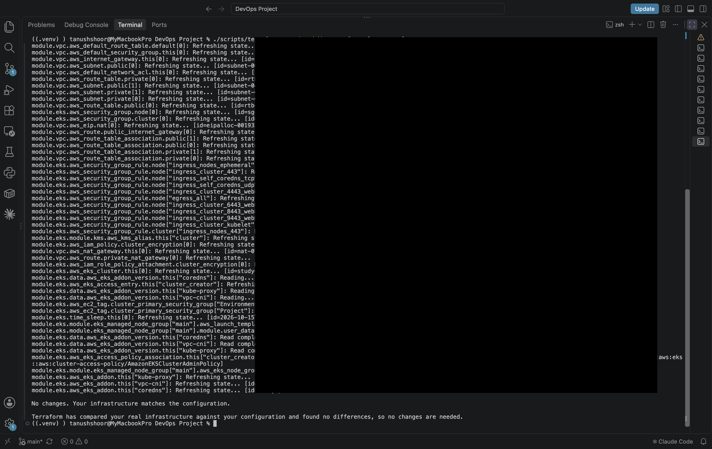
</p>

**Terraform plan evidence note:** these are post-apply checks showing **No changes**. The original reviewed deployment plan was **4 to add, 0 to change, 0 to destroy**, but its non-empty output was not saved in the evidence folder.

<p align="center">
  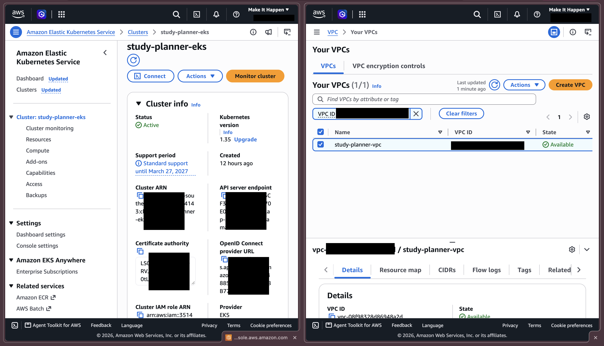
  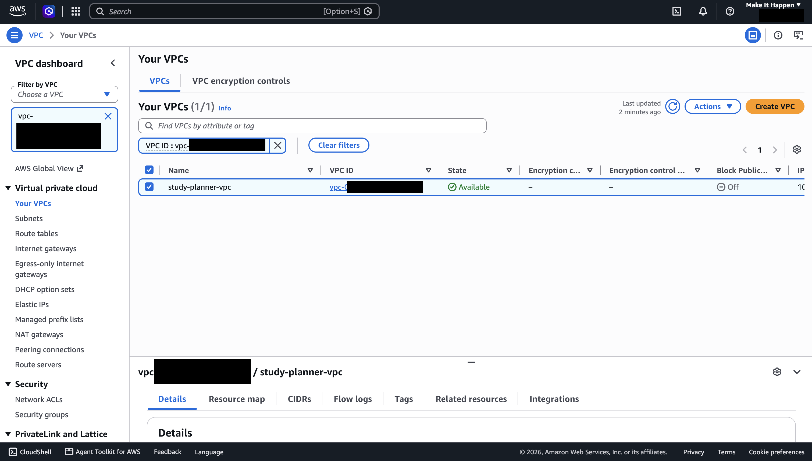
</p>
<p align="center">
  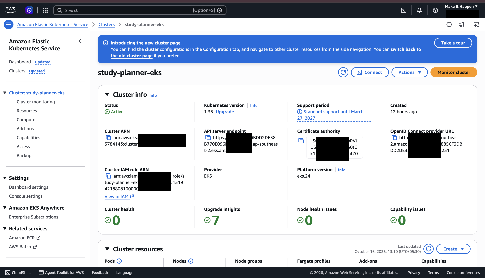
</p>

## Kubernetes and Helm deployment

The Helm chart in [`helm/taskboard/`](helm/taskboard/) deploys the frontend and backend with two replicas each, PostgreSQL, ClusterIP Services, and an Ingress. In the captured cluster, Kubernetes scheduled the application pods, Services provided stable internal endpoints, and the Helm release recorded the deployed chart. The Ingress load balancer made the application reachable in a browser.

<p align="center">
  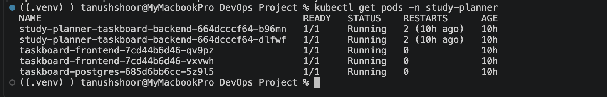
  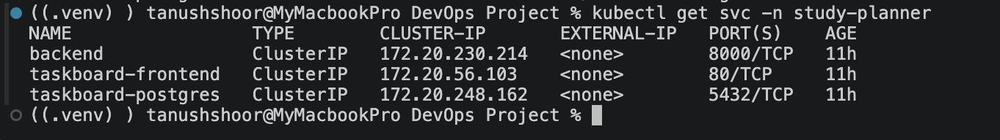
</p>
<p align="center">
  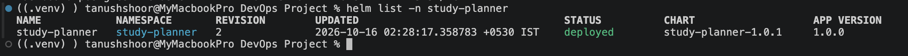
  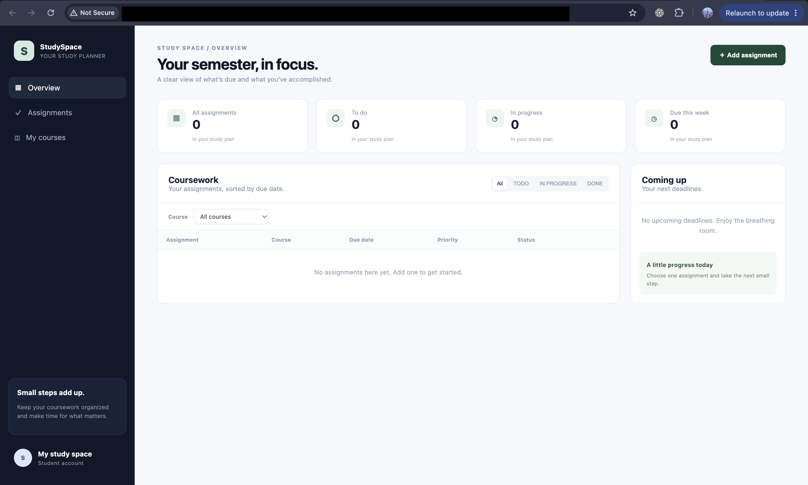
</p>

The AWS cluster and load balancer are no longer active, so the captured Ingress address is not a current app URL. To recreate the environment, install AWS CLI v2, Terraform, `kubectl`, and Helm, sign in to an AWS account, inspect the current account terms and billing, then review the Terraform plan before applying. Never commit access keys, session tokens, kubeconfig, Terraform state, or local plan files.

The project used the following commands during provisioning:

```bash
aws login --profile studyspace --region ap-southeast-2
aws sts get-caller-identity --profile studyspace
./scripts/terraform-aws.sh -chdir=terraform init
./scripts/terraform-aws.sh -chdir=terraform validate
./scripts/terraform-aws.sh -chdir=terraform plan -out=studyspace.tfplan
./scripts/terraform-aws.sh -chdir=terraform show studyspace.tfplan
```

Review the full plan and AWS billing/credit information before provisioning. After a cluster is available, connect `kubectl` and follow the deployment steps in [`scripts/deploy-eks.sh`](scripts/deploy-eks.sh). Destroy the resources after use:

```bash
./scripts/terraform-aws.sh -chdir=terraform destroy
```

The final destroy reported **58 resources destroyed**; the EKS cluster was verified absent and Terraform state was empty. The Kubernetes-created public load balancer and its security group were removed during cleanup as well.


## Monitoring with Prometheus and Grafana

The backend exposes metrics at `/metrics`. [`monitoring/prometheus-values.yaml`](monitoring/prometheus-values.yaml) configures the Prometheus Operator stack, while [`monitoring/grafana-studyspace-dashboard.yaml`](monitoring/grafana-studyspace-dashboard.yaml) provisions the StudySpace API Overview dashboard. Panels cover request rate, p95 latency, 5xx rate, and backend scrape health.

The Prometheus capture shows both backend replicas `UP`. The Grafana capture shows request-rate data and backend health as `UP`; the p95 and 5xx panels have no samples in that capture.

<p align="center">
  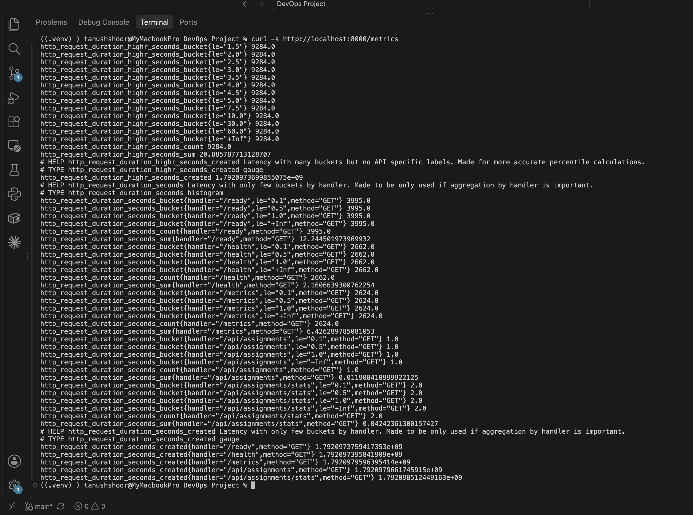
  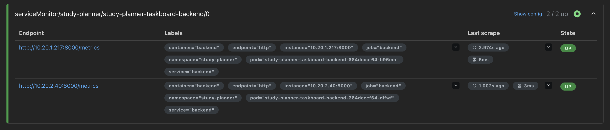
</p>
<p align="center">
  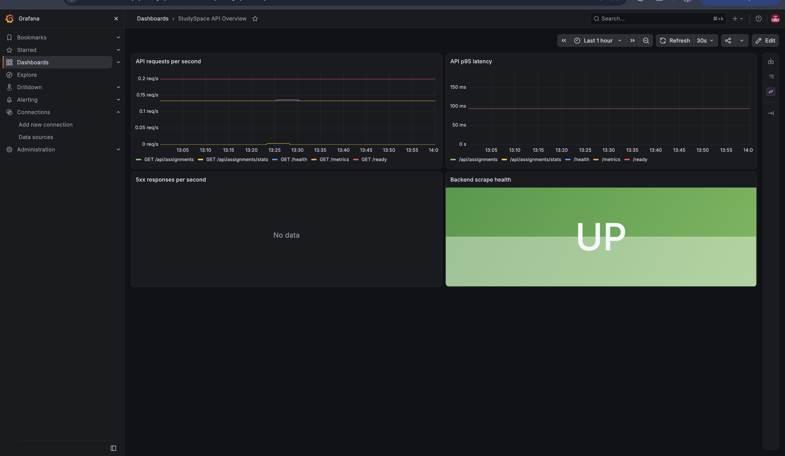
</p>

For a running cluster, port-forward Grafana and Prometheus:

```bash
kubectl port-forward -n monitoring svc/kube-prometheus-stack-grafana 3001:80
kubectl port-forward -n monitoring svc/kube-prometheus-stack-prometheus 19090:9090
```

Then open [Grafana](http://localhost:3001/d/studyspace-overview/studyspace-api-overview) and [Prometheus targets](http://localhost:19090/targets). Grafana's username is `admin`; retrieve its generated password with:

```bash
kubectl get secret -n monitoring kube-prometheus-stack-grafana -o jsonpath='{.data.admin-password}' | base64 --decode; echo
```

These addresses work only while the cluster exists and the port-forward processes are running.

## Submission and grading map

The project evidence is organized to match the rubric modules in [`GRADING.md`](GRADING.md):

| Rubric module | Implementation and evidence |
| --- | --- |
| M1 Application | `backend/app/`, `backend/alembic/`, `frontend/`, Compose, `01-local-app.png` |
| M2 Testing | `backend/tests/`, pytest configuration, `02-pytest.png` (6 passed) |
| M3 Git and GitHub | public repository, commit history and `05-github-commits.png` |
| M4 Docker | service Dockerfiles, Compose, `03-compose-startup.png`, `04-compose-containers.png` |
| M5 CI/CD | GitHub Actions workflow, successful run, SHA-tagged GHCR images |
| M6 DevSecOps | Trivy scans of both images and GHCR evidence |
| M7 Terraform | AWS VPC/EKS, plan checks and destroy evidence |
| M8 Kubernetes + Helm | pods, Services, Helm release and Ingress evidence |
| M9 Observability | backend metrics, Prometheus targets and Grafana dashboard |
| M10 Presentation + docs | this README and `StudySpace-DevOps-Capstone.pptx` |

The 27-slide PowerPoint includes the project evidence screenshots in the corresponding sections. A PDF export is included for convenient viewing.

## Repository layout

```text
backend/          FastAPI application, Alembic migrations, and pytest tests
frontend/         React + Vite application and unprivileged multi-stage Dockerfile
helm/             Kubernetes application chart
k8s/              Namespace manifest
monitoring/       Prometheus configuration and Grafana dashboard provisioning
terraform/        AWS VPC and EKS infrastructure
scripts/          AWS credential bridge and deployment helpers
troubleshooting/  Deliberately broken manifests for practice
evidence/         Screenshots documenting the capstone workflow
```

## Security and credentials

Do not commit `.env` files, AWS credentials, session tokens, kubeconfig, Terraform state, or local Terraform plans. The repository `.gitignore` excludes these local files. The Terraform code does not provision infrastructure until an operator reviews and applies a plan.
